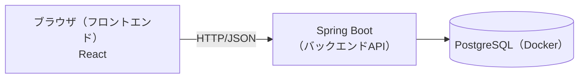
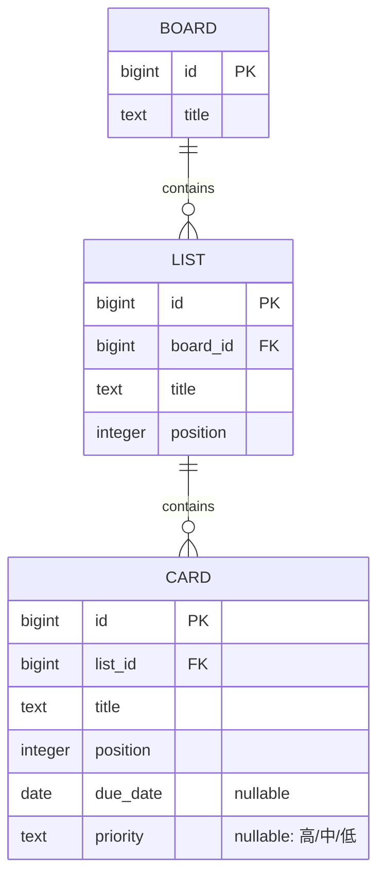

# データベース設計

使用技術（Java / Spring Boot / PostgreSQL）の選定理由は [技術スタック](./tech-stack.md) を参照。

## システム構成

- フロントエンドはAPI（例: `GET /api/board`, `POST /api/lists/{listId}/cards`, `PATCH /api/cards/{id}`, `DELETE /api/cards/{id}`）経由でデータを取得・更新する
- バックエンドがPostgreSQLへの読み書きを担当し、フロントエンドは直接DBにアクセスしない

## データ構造（ER図）

実装上のテーブル名は `boards` / `lists` / `cards`。`LIST`はJavaの`java.util.List`と名前が衝突するため、エンティティクラス名は`BoardList`としている。

## 補足

- `lists.board_id` と `cards.list_id` で親を参照する（外部キー）
- `cards.due_date` は期限が未設定のカードでは `NULL` を許容する
- `cards.priority` は優先度が未設定のカードでは `NULL` を許容し、値は `高` / `中` / `低` のいずれか
- `position` は列内でのカード（または列自体）の並び順。「優先度順」「期限順」ボタンによる並び替え、またはドラッグ&ドロップによる手動の並び替えのたびに、対象リスト内の全カードのpositionを再採番する
- idはPostgreSQLの自動採番（`GenerationType.IDENTITY`）とする
- テーブルはSpring Data JPA（Hibernate）の`ddl-auto=update`により自動生成される
