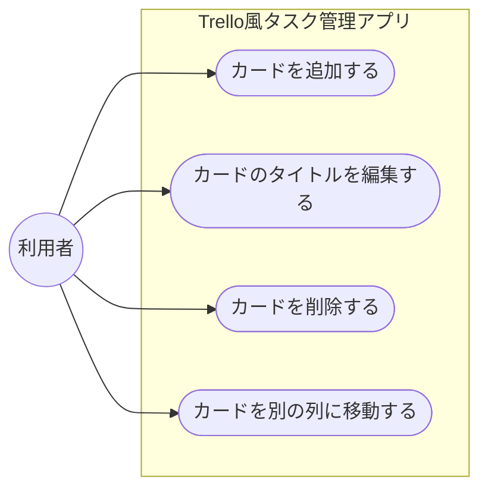

# 機能要件

機能の一覧は [機能一覧](./features.md) を参照。

## 受け入れ基準

フェーズ1（基本機能）について、以下をすべて満たした時点で完成とする。

- [x] 「未着手」「進行中」「完了」の3列がブラウザ上に表示される
- [x] 任意の列にカードを新規追加できる
- [x] 追加したカードのタイトルを編集できる
- [x] カードを削除できる
- [x] カードをドラッグ&ドロップで別の列に移動できる
- [x] カードに期限（日付）・優先度を設定・編集できる
- [x] カードは列内でドラッグ&ドロップにより自由な順序に並び替えられる
- [x] 列ごとに「優先度順」ボタンを押すと、その時点でカードが優先度順に並び替えられる
- [x] 列ごとに「期限順」ボタンを押すと、その時点でカードが期限順に並び替えられる（期限未設定のカードは末尾）
- [x] 上記のボタンによる並び替えは実行した時点のみ適用され、以降は自由に並び替えられる
- [x] 上記の操作をエラーなく繰り返し行える

## ユースケース

アクターは「利用者（自分）」の1人のみ。Mermaidに正式なユースケース図の記法はないため、`flowchart`で代用する（楕円＝ユースケース）。

| ユースケース | 概要 | 関連する受け入れ基準 |
| --- | --- | --- |
| カードを追加する | 任意の列に新しいカードを作成する | 任意の列にカードを新規追加できる |
| カードのタイトルを編集する | 既存カードのタイトルを書き換える | 追加したカードのタイトルを編集できる |
| カードを削除する | 不要になったカードを削除する | カードを削除できる |
| カードを別の列に移動する | カードの進捗状況（列）を変更する | カードを別の列に移動できる |

画面上での具体的な操作は [画面設計](./screen-design.md) を参照。
