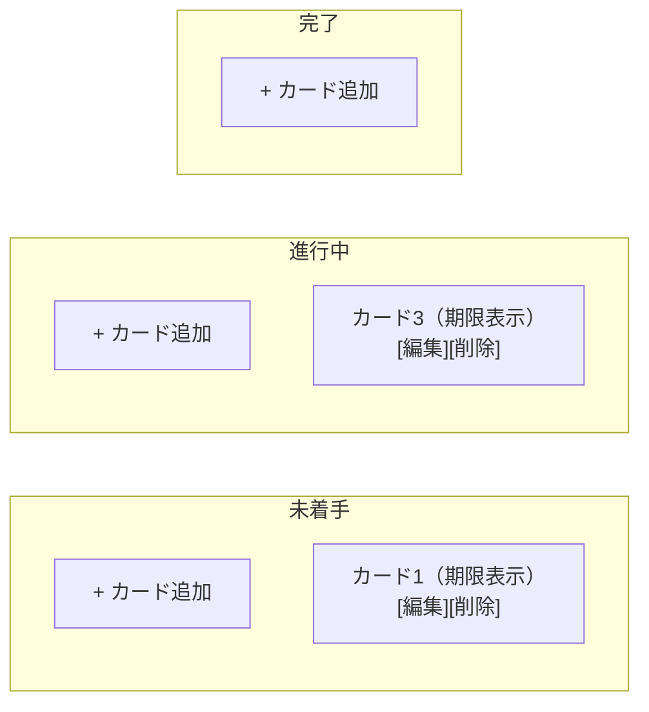
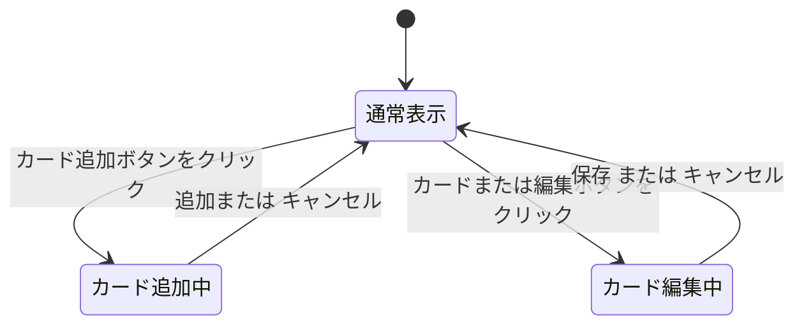

# 画面設計

対応する機能・受け入れ基準は [機能要件](./functional-requirements.md) を参照。

## ボード画面（唯一の画面）

トップ画面（ボード画面）はカンバン形式とし、横に並んだ3つの列（未着手 / 進行中 / 完了）の中にカードが縦に並ぶレイアウトとする。

カードはドラッグ&ドロップで、隣接しない列を含む任意の列・任意の位置へ移動できる（同一列内での並び替えも可能）。並び順は基本的に手動（自由）だが、列ごとの「優先度順」「期限順」ボタンを押すとその時点でのみ並び替えが行われる。

## 要素と操作

| 要素 | 説明 | 操作 |
| --- | --- | --- |
| 列見出し | 「未着手」「進行中」「完了」を表示 | なし（フェーズ1では固定） |
| 並び替えボタン（優先度順／期限順） | 各列の見出し右に配置 | クリックした時点でその列のカードを優先度順／期限順に並び替える（以降は自由に並び替え可能） |
| カード追加ボタン | 各列の上部に配置 | クリックでタイトル・期限・優先度の入力欄を表示し、入力して追加 |
| カード | タイトル・期限／優先度（設定時のみ）・操作ボタンを表示 | ドラッグで列内の任意の位置、または別の列へ移動。クリックでタイトルを編集状態にする |
| 編集ボタン | カード内に配置 | クリックでタイトル・期限・優先度をその場で編集可能にする |
| 削除ボタン | カード内に配置 | クリックでカードを削除する（確認なし） |

## 状態遷移

フェーズ1では画面は1枚のみで、カード単位の表示状態が変化する。

- 削除ボタンは通常表示のまま即座に処理され、状態遷移は発生しない
- カードのドラッグによる移動、並び替えボタンによる並び替えも通常表示のまま即座に処理され、状態遷移は発生しない
